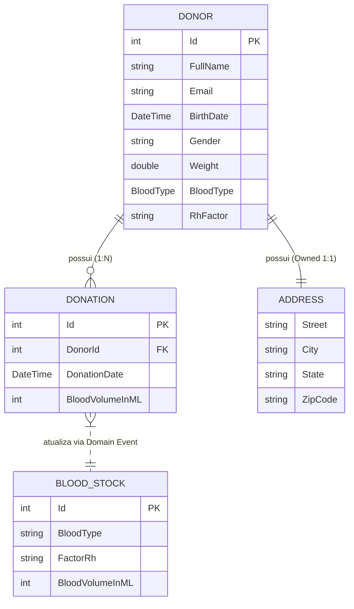

# API_FRONTEND_PLAN: Análise Completa da API BloodLink para Integração com Frontend

Este documento contém a análise detalhada e o mapeamento técnico da API **BloodLink** para subsidiar a criação e integração da camada de frontend.

---

## 1. Tecnologia e Versão

- **Framework / Runtime**: .NET 8.0 (C# 12 / ASP.NET Core Web API).
- **Arquitetura**: Clean Architecture / DDD (separada em `BloodLink.API`, `BloodLink.Application`, `BloodLink.Core`, `BloodLink.Infrastructure`).
- **Padrão CQRS / Mediação**: MediatR 12.4.0.
- **ORM & Acesso a Dados**:
  - Entity Framework Core 8.0.7 (SQL Server / In-Memory).
  - Dapper 2.1.35 (consultas otimizadas em queries específicas).
- **Validação de Entrada**: FluentValidation 11.3.0 + Action Filter personalizado (`ValidationFilter`).
- **Documentação de API**: Swashbuckle / Swagger (OpenAPI 3.0 / Swashbuckle 6.4.0).
- **Integrações Externas**: Refit 7.1.2 e Flurl.Http 4.0.2 para consulta ao serviço ViaCEP (`IViaCepService`).
- **Serviços em Segundo Plano**: `StockMonitorHostedService` (monitora níveis críticos de estoque).

---

## 2. Controllers e Endpoints

A API expõe 3 controllers principais sob o prefixo `/api`:

### 2.1. `DonorsController` (Rota base: `api/donors`)
| Método | Rota | Descrição |
| :--- | :--- | :--- |
| `GET` | `/api/donors` | Lista doadores paginados com suporte a termo de busca. |
| `GET` | `/api/donors/{id}` | Obtém os dados completos de um doador por ID. |
| `POST` | `/api/donors` | Cadastra um novo doador (busca automática de endereço via CEP). |
| `PUT` | `/api/donors/{id}` | Atualiza os dados cadastrais do doador. |

### 2.2. `DonationsController` (Rota base: `api/donation`)
| Método | Rota | Descrição |
| :--- | :--- | :--- |
| `GET` | `/api/donation` | Lista doações paginadas gerais. |
| `GET` | `/api/donation/{id}` | Busca os detalhes de uma doação específica pelo seu ID. |
| `GET` | `/api/donation/by-donorId` | Lista doações paginadas filtradas por `donorId`. |
| `GET` | `/api/donation/recentDonations` | Lista das doações mais recentes (para dashboard/visão rápida). |
| `POST` | `/api/donation` | Registra uma nova doação de sangue e dispara incremento de estoque. |

### 2.3. `ReportsController` (Rota base: `api/reports`)
| Método | Rota | Descrição |
| :--- | :--- | :--- |
| `GET` | `/api/reports` | Consulta o saldo de estoque atual de sangue (por tipo e Rh). |
| `GET` | `/api/reports/last-30-days` | Relatório consolidado das doações realizadas nos últimos 30 dias. |

---

## 3. Métodos HTTP Utilizados

- **`GET`**: Leitura de recursos, buscas paginadas, detalhes por identificador e relatórios analíticos.
- **`POST`**: Criação de recursos (`/api/donors` e `/api/donation`).
- **`PUT`**: Atualização completa de entidade (`/api/donors/{id}`).
- *Observação*: Não há endpoints configurados com `DELETE` ou `PATCH`.

---

## 4. DTOs de Entrada e Saída

### 4.1. DTOs de Entrada (Request Models / Commands / Queries)

#### `CreateDonorCommand` (`POST /api/donors`)
```typescript
{
  fullName: string;      // Obrigatório
  email: string;         // Obrigatório, formato de e-mail válido e único
  birthDate: string;     // ISO 8601 (yyyy-MM-dd)
  gender: string;        // "Masculino" | "Feminino" (ou "Male" | "Female")
  weight: number;        // Peso em kg (mínimo de 50kg para doação)
  bloodType: string;     // "A" | "B" | "AB" | "O"
  rhFactor: string;      // "+" | "-"
  zipCode: string;       // CEP de 8 dígitos (ex: "01001-000" ou "01001000")
}
```

#### `UpdateDonorCommand` (`PUT /api/donors/{id}`)
```typescript
{
  id: number;
  fullName: string;
  email: string;
  cpf: string;
  birthDate: string;
  gender: string;
  weight: number;
  bloodType: string;
  rhFactor: string;
  address: {
    street: string;
    city: string;
    state: string;
    zipCode: string;
  };
  updatedAt: string;
}
```

#### `GetAllDonorsQuery` (`GET /api/donors?SearchTerm={termo}&Page={pagina}`)
- `SearchTerm` (string, opcional): filtra por nome do doador.
- `Page` (int, padrão: 1): número da página.

#### `CreateDonationCommand` (`POST /api/donation`)
```typescript
{
  donorId: number;           // ID do doador existente
  bloodVolumeInML: number;   // Volume entre 420 ml e 470 ml
}
```

#### `GetAllDonationsQuery` (`GET /api/donation?Query={termo}&Page={pagina}`)
- `Query` (int, opcional)
- `Page` (int, padrão: 1)

#### `GetDonationsByDonorIdQuery` (`GET /api/donation/by-donorId?DonorId={id}&Page={pagina}`)
- `DonorId` (int, obrigatório): ID do doador para filtrar histórico.
- `Page` (int, padrão: 1).

#### `GetAllBloodStocksQuery` (`GET /api/reports?Query={termo}&Page={pagina}`)
- `Query` (string, opcional)
- `Page` (int, padrão: 1)

---

### 4.2. DTOs de Saída (Response Models / ViewModels)

#### Wrapper Genérico de Resposta (`ResultViewModel<T>`)
Retornado em mutações (`POST /api/donors`, `POST /api/donation`):
```typescript
{
  isSuccess: boolean;
  message: string;
  data?: T; // Ex: number (id gerado)
}
```

#### Wrapper Genérico de Paginação (`PaginationResult<T>`)
Retornado nas listagens paginadas:
```typescript
{
  page: number;
  totalPages: number;
  pageSize: number;
  itemsCount: number;
  data: T[];
}
```

#### `DonorViewModel` (`GET /api/donors/{id}` e itens de `GET /api/donors`)
```typescript
{
  id: number;
  fullName: string;
  email: string;
  birthDate: string;
  gender: string;
  weight: number;
  bloodType: string;
  rhFactor: string;
  donations: Array<{
    id: number;
    donorId: number;
    donationDate: string;
    bloodVolumeInML: number;
  }>;
}
```

#### `RecentDonationViewModel` (`GET /api/donation/recentDonations`)
```typescript
{
  donationId: number;
  donorName: string;
  bloodType: string;
  factorRh: string;
  donationDate: string;
  bloodVolumeInML: number;
}
```

#### `BloodStockReportViewModel` (`GET /api/reports`)
```typescript
{
  bloodType: string;      // "A", "B", "AB", "O"
  factorRh: string;       // "+", "-"
  bloodVolumeInML: number; // Volume total acumulado em ml
}
```

#### `DonationReportViewModel` (`GET /api/reports/last-30-days`)
```typescript
{
  donationId: number;
  donorId: number;
  donorName: string;
  donorEmail: string;
  bloodType: string;
  bloodVolumeML: number;
  donationDate: string;
}
```

---

## 5. Autenticação e Autorização

- **Estado Atual**: **Não implementada / Desabilitada**.
- Nenhum endpoint ou controller possui atributo `[Authorize]`.
- O pipeline em `Program.cs` possui `app.UseAuthorization()`, porém não registra serviços de autenticação (como JWT Bearer, Cookie ou Identity).
- **Impacto para o Frontend**:
  - Todas as chamadas à API podem ser feitas anonimamente (sem envio de header `Authorization: Bearer <token>`).
  - Não é necessário implementar fluxo de Login, Refresh Token ou guarda de rotas auth no momento.

---

## 6. Paginação, Filtros e Ordenação

### Paginação
- Padronizada via objeto `PaginationResult<T>`.
- Parâmetro de requisição: `Page` (1-indexed).
- Tamanho padrão de página (`PageSize`): 10 itens por padrão no repositório.
- A resposta devolve metadados: `page`, `totalPages`, `pageSize`, `itemsCount`.

### Filtros
- **Doadores**: filtro textual `SearchTerm` (aplica busca no nome do doador).
- **Doações**: filtro por identificador `DonorId` (`/api/donation/by-donorId`).
- **Relatório temporal**: filtro pré-fixado de 30 dias (`/api/reports/last-30-days`).
- **Doações recentes**: consulta fixa das últimas coletas ordenadas por data descendente.

### Ordenação
- **Não há ordenação dinâmica exposta**: Não existem parâmetros como `sortBy` ou `sortOrder` nas queries.
- A ordenação é embutida nas consultas do backend (ex: `DonationDate DESC`).

---

## 7. Relacionamentos entre Entidades



### Regras de Negócio Importantes Vinculadas aos Relacionamentos:
1. **Endereço do Doador**: Obtido de forma desacoplada no `CreateDonorCommandHandler` através da API ViaCEP pelo `zipCode`.
2. **Elegibilidade para Doação**:
   - Idade entre 18 e 69 anos (`donor.IsEligibleByAge()`).
   - Peso mínimo de 50 kg (`donor.IsEligibleByWeight()`).
   - Intervalo mínimo entre doações:
     - **Homens**: 60 dias.
     - **Mulheres**: 90 dias.
   - Volume de sangue por coleta: entre **420 ml e 470 ml**.
3. **Consistência de Estoque**:
   - Quando uma doação é persistida com sucesso, um evento de domínio (`DonationCreatedNotification`) incrementa automaticamente o saldo de `BloodStock` correspondente ao tipo sanguíneo e fator Rh do doador.

---

## 8. Códigos de Resposta HTTP (Status Codes)

| Código | Ocorrências na API |
| :--- | :--- |
| **`200 OK`** | Retornado em leituras bem-sucedidas (`GET /api/donors`, `GET /api/donors/{id}`, `GET /api/donation/*`, `GET /api/reports/*`). |
| **`201 Created`** | Retornado em criações bem-sucedidas (`POST /api/donors`, `POST /api/donation`), contendo o cabeçalho `Location` apontando para o recurso criado via `CreatedAtAction`. |
| **`204 NoContent`** | Retornado na atualização cadastral de doador (`PUT /api/donors/{id}`). |
| **`400 BadRequest`** | Falha de validação no FluentValidation (`ValidationFilter`), parâmetro incompatível ou violação de regra de negócio/domínio (ex: intervalo de doação inválido, peso menor que 50kg, volume de sangue fora da faixa). |
| **`404 NotFound`** | Identificador de doador ou doação inexistente no banco. |
| **`500 InternalServerError`** | Exceções não tratadas capturadas pelo middleware `GlobalExceptionHandler`, serializadas no formato RFC 7807 (`ProblemDetails`). |

---

## 9. Uploads e Downloads de Arquivos

- **Não há endpoints de upload**: Nenhum endpoint consome `multipart/form-data`, `IFormFile` ou fluxo de binários.
- **Não há endpoints de download**: Nenhum endpoint gera arquivos físicos, relatórios PDF ou planilhas Excel em formato binário (`FileContentResult` / `FileStreamResult`).
- Toda a comunicação da API é estritamente **JSON** (`application/json`).

---

## 10. Endpoints que Formam Operações CRUD

| Entidade | Create (C) | Read (R) | Update (U) | Delete (D) | Observação |
| :--- | :--- | :--- | :--- | :--- | :--- |
| **Doador (`Donor`)** | `POST /api/donors` | `GET /api/donors`<br/>`GET /api/donors/{id}` | `PUT /api/donors/{id}` | *Inexistente* | CRUD quase completo (falta remoção/soft-delete). |
| **Doação (`Donation`)** | `POST /api/donation` | `GET /api/donation`<br/>`GET /api/donation/{id}`<br/>`GET /api/donation/by-donorId`<br/>`GET /api/donation/recentDonations` | *Inexistente* | *Inexistente* | Imutável: doações representam fatos históricos/médicos que não podem ser alterados ou deletados diretamente. |
| **Estoque de Sangue (`BloodStock`)** | *Automático* | `GET /api/reports` | *Automático* | *Inexistente* | O estoque é mantido e incrementado via eventos de doação. |
